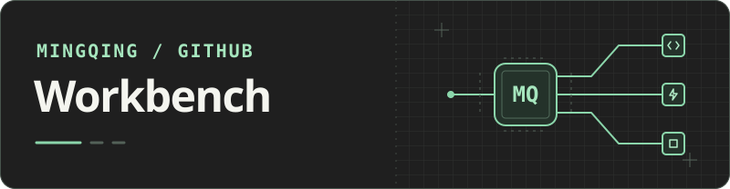

# 我是 Mingqing

我喜欢把重复的工作做成工具，也会为好用的工具打磨界面。这里收录了我在本地 AI、流程自动化和产品设计上的实践。

**[查看作品集 PDF ↗](https://mingqing-h.github.io/portfolio-pdf/)**

## 精选项目

- **[Muse PI](https://github.com/Mingqing-H/Muse-PI)** · 本地 AI 对话工具。可以切换模型，也能让 Pi CLI 在指定项目里读写代码。
- **[Financial Automation Dong](https://github.com/Mingqing-H/Financial-Automation-Dong)** · 财务流程自动化项目。
- **[Web MQ](https://github.com/Mingqing-H/Web-MQ)** · 个人网站项目。
