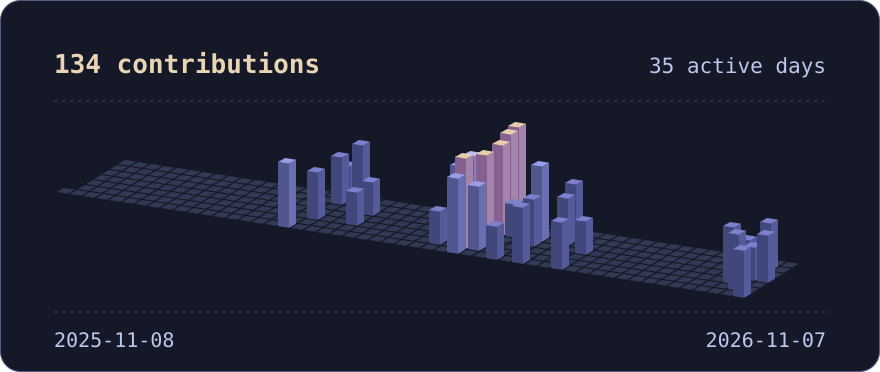

<picture>
  <source media="(prefers-reduced-motion: reduce)" srcset="assets/mq-fm-still.svg">
  
</picture>

我喜欢把重复的工作做成工具，再把工具做得顺手一点。

## 项目播放列表

| 曲目 | 项目 |
| :--- | :--- |
| `01` | [▶ 作品集 PDF](https://mingqing-h.github.io/portfolio-pdf/) · 项目与设计案例 |
| `02` | [▶ Muse PI](https://github.com/Mingqing-H/Muse-PI) · 在本地切换 AI 模型，让 Pi CLI 在项目里读写代码 |
| `03` | [▶ Financial Automation Dong](https://github.com/Mingqing-H/Financial-Automation-Dong) · 财务流程自动化 |
| `04` | [▶ Web MQ](https://github.com/Mingqing-H/Web-MQ) · 个人网站 |

## 贡献地形

